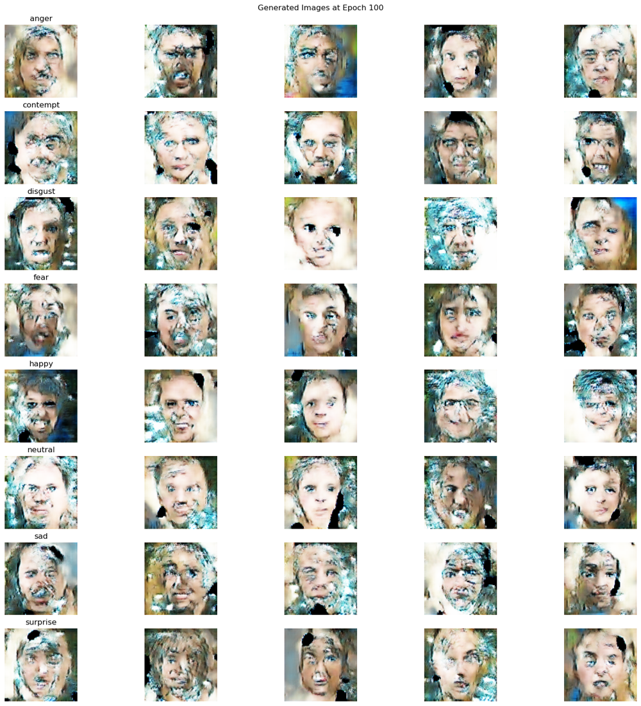
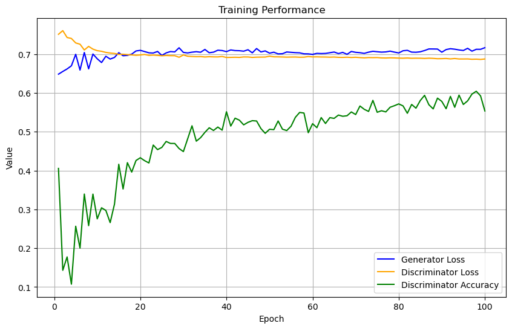
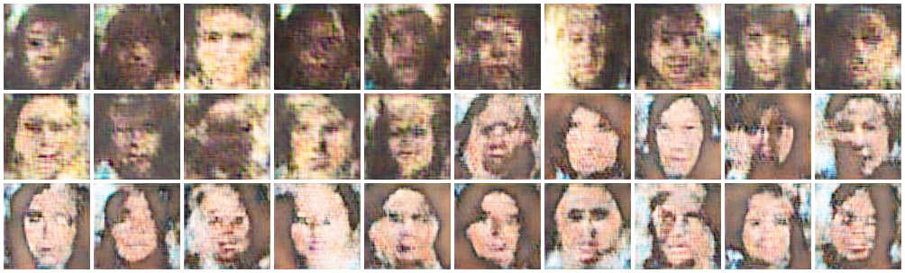

# GAN and Conditional GAN for Face Images

A DCGAN that generates face images, and a conditional GAN (cGAN) that generates faces for a chosen facial expression. Both are written in TensorFlow/Keras.

Group assignment for Deep Learning Methods and Applications (M.Sc. Data Science, Dokuz Eylül University, January 2025), by Mustafa Öngün, Tarık Tuna Taşaltı and Büşra Sulak.

## Conditional GAN

*Generated 48×48 faces after 100 epochs. Each row is conditioned on one of the eight expression labels.*

The generator takes a 128-dimensional noise vector together with a one-hot expression label and upsamples it to a 48×48 colour image. The discriminator receives the image and the label (projected to a 48×48 map and stacked as an extra channel) and decides whether the pair is real. Training follows the standard adversarial loop in a custom `train_step`.

*Generator loss, discriminator loss and discriminator accuracy per epoch.*

## Unconditional GAN

*96×96 faces generated by the unconditional DCGAN.*

The generator maps a 100-dimensional noise vector to a 96×96 image through upsampling and convolution blocks; the discriminator is a five-layer strided convolutional network.

## Files

| File | What |
|---|---|
| `gan/gan.py` | Unconditional DCGAN, 96×96 |
| `cgan/cgan.py` | Conditional GAN, 48×48, eight expression labels |
| `cgan/cgan_rapor.Rmd` | Report explaining each step of the cGAN code (Turkish) |
| `figures/` | Samples and training curves shown above |

## Data

A face expression dataset from Kaggle with eight labels (anger, contempt, disgust, fear, happy, neutral, sad, surprise). The images are not included. The scripts expect them under `./DATA2/`, with a `labels.csv` file that lists each image path (`pth`) and its label for the cGAN, and the images under `./DATA2/all_photos/` for the GAN.

## Requirements

Python 3 with TensorFlow, NumPy, pandas, scikit-learn, Matplotlib, seaborn, tqdm and Pillow.
